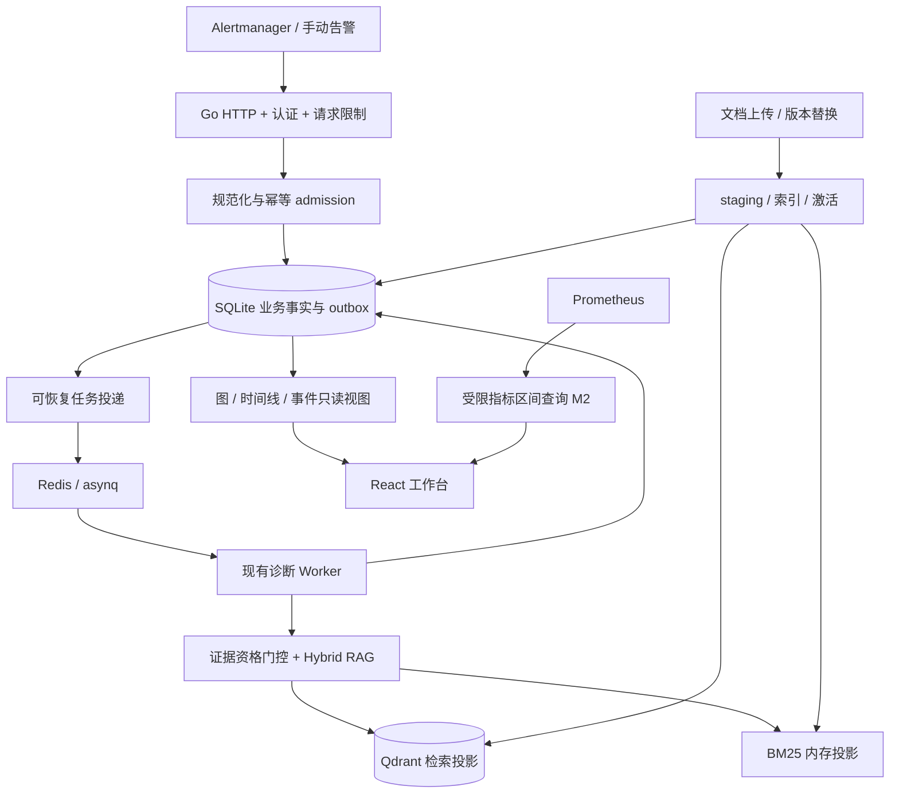

# oncall-agent · Codex 完整交接规范

版本1.1 · 2026-10-05 · 全7页概念图补齐

本文件汇总全部规范章节。完整ZIP包含七张原始PNG、逐页映射、任务JSON、schema、夹具及审查复现；单独一份Markdown不包含这些二进制/机器可读材料。

**执行入口：[CODEX_START.md](CODEX_START.md)。默认范围：M0可靠性 → M1证据工作台 → M2服务拓扑与指标联动；M3 Semantica/GraphRAG延后。**

这是执行交接，不是已实现的软件。本次仅补齐新图及实施映射，不声称已实施或联调。

## 七页视觉索引

原始图片保持字节不变；图片内容的示例指标/功能必须依规范修正。登录/移动端/所有子状态未单独出图。

- [UI-S01 · 仪表盘](design/reference/01-dashboard.png) — M1 摘要与健康状态；M2 真实趋势
- [UI-S02 · 事件工作台](design/reference/ui-concept-original.png) — M1 完整核心工作区
- [UI-S03 · 证据图谱](design/reference/03-evidence-graph.png) — M1 当前事件图；M3 全局探索延后
- [UI-S04 · 指标联动](design/reference/04-metrics.png) — M2 指标与事件联动
- [UI-S05 · 知识库](design/reference/05-knowledge-base.png) — M1 文档与历史版本管理
- [UI-S06 · 评测](design/reference/06-evaluation.png) — M1 真实结果/未配置态；不扩建评测平台
- [UI-S07 · 设置](design/reference/07-settings.png) — M1 只读配置摘要与偏好；不扩建密钥管理

[离线图片图集](design/gallery.html) · [逐页说明](docs/10_SCREEN_REFERENCE_MAP.md) · [机器索引](design/screens.json)

## 章节
- [00_CONTEXT_AND_DECISIONS](docs/00_CONTEXT_AND_DECISIONS.md)
- [01_RELIABILITY_BACKLOG](docs/01_RELIABILITY_BACKLOG.md)
- [02_ARCHITECTURE_AND_DATA](docs/02_ARCHITECTURE_AND_DATA.md)
- [03_API_CONTRACT](docs/03_API_CONTRACT.md)
- [04_UI_VISUAL_CONTRACT](docs/04_UI_VISUAL_CONTRACT.md)
- [05_IMPLEMENTATION_PLAN](docs/05_IMPLEMENTATION_PLAN.md)
- [06_ACCEPTANCE_TESTS](docs/06_ACCEPTANCE_TESTS.md)
- [07_OPERATIONS_AND_MIGRATION](docs/07_OPERATIONS_AND_MIGRATION.md)
- [08_FUTURE_AND_SEMANTICA](docs/08_FUTURE_AND_SEMANTICA.md)
- [09_SOURCES_AND_TRACEABILITY](docs/09_SOURCES_AND_TRACEABILITY.md)
- [10_SCREEN_REFERENCE_MAP](docs/10_SCREEN_REFERENCE_MAP.md)


---

# 00 · 上下文、范围与决策

## 1. 输入与证据等级

输入一：对话内源码审查，固定于 `2e97742aae610b52535999a9851683320c349c6e`，报告与四项摘录逻辑复现已附入 `reference/audit/`。[SRC-01][SRC-02]

输入二：图与可视化讨论，方向为“证据优先、事件为中心”，借鉴 Semantica 的邻域探索、路径高亮、时间切片和来源检查器，不默认移植其整个框架。[SRC-04][SRC-05]

输入三：用户要求重新设计 UI，并后续要求每个主页面出图。v1.1保留事件工作台原图，并补齐仪表盘、证据图谱、指标联动、知识库、评测、设置六张，合计七张；第10章映射逐页布局和语义修正。概念图不是生产观测，不扩大既定实现范围。[SRC-03][SRC-10][SRC-11][SRC-12][SRC-13][SRC-14][SRC-15]

本包对目标系统的架构、字段和限额是新增实施规范，不声称已存在。此前审查没有做完整目标仓库 build/test/race 或真实基础设施联调。v1.0编制时仅复核远端 main 与旧基线一致，并读取现有 AGENTS 约束；v1.1仅更新交接材料和视觉附件，没有再次读取远端HEAD，不冒充重新做了全量审计。[SRC-01][SRC-02][SRC-06]

## 2. 产品目标

用户从一个事件出发，能确认：收到什么告警；系统实际查了什么；引用哪个版本；哪一步失败/重试；报告哪些内容尚无依据；哪些依赖或指标仍未知。主动作是检查与追溯，不是自动处置。

首版用户模型为单机个人或受限小团队；仅一套工作空间。environment/service 是业务过滤维度，不是多租户隔离的替代物；未授权跨环境数据仍由服务端约束。

## 3. 范围锁定

| 阶段 | 必须实现 | 不属于该阶段 |
|---|---|---|
| M0 | R01–R15 风险收口、SQLite 事实持久化、身份与状态契约、非破坏迁移 | 新根因模型、更多 Agent 工具 |
| M1 | 事件列表/详情、证据图、引用检查器、真实阶段时间线、知识文档管理、数据状态、显式演示模式 | 声称全服务拓扑/根因确认、全局图探索 |
| M2 | 文件声明的服务拓扑、潜在影响范围、Prometheus 指标区间查询与事件联动、真实摘要趋势 | 自动分布式拓扑发现、变更平台/日志平台完整集成 |
| M3 | 仅文档：全局知识探索、实体消歧、Semantica 导出/侧车试验、GraphRAG shadow evaluation | 默认实现或加入线上必要依赖 |

除非用户明确减少范围，Codex 的目标是交付 M0–M2；M1 是可独立交付的首版。不要把概念图每一个菜单名都推导为必须建设完整独立子系统。

## 4. 技术决定

| ID | 决定 | 代价与边界 |
|---|---|---|
| D01 | 保留 Go/Gin/Agent 结构与既有基础设施 | 不做语言迁移；改动尽量集中在领域服务和 adapter |
| D02 | SQLite 保存业务事实、文档版本、检索关联、运行事件与少量 outbox | 单实例部署、可备份目录；暂不支持多副本并发写 |
| D03 | Qdrant / BM25 是检索投影，图是关系读模型 | 必须实现投影恢复和版本过滤，不能假设多系统原子提交 |
| D04 | React + TypeScript + Vite；React Flow + ELK；M2 按需 ECharts | 不引入 Next.js/SSR；浏览器端渲染应用，无独立生产 Node 服务 |
| D05 | M1 使用 HTTP 轮询，保留未来 SSE 路径设计但不实现 | 5 秒前台刷新，页面不可见暂停；中断显式 stale，无伪实时 |
| D06 | 候选假设是独立未核验断言，不自动入可信库 | M1 不增加假设生成器；已有证据不足就展示不足 |
| D07 | auto_ingest 默认关闭；runbook 来源不等于审核通过 | 后续引入审核也不能把 LLM-as-judge 当真值 |
| D08 | 单机轻量认证，无 OAuth/企业 RBAC 平台 | 浏览器短会话；AM 独立入站 token；所有敏感接口统一保护 |
| D09 | 旧 HTTP endpoint 保留兼容适配，新 UI 用 /api/v1 | 安全语义修正可以改变失败行为，必须写迁移说明 |
| D10 | 原概念图优先，语义与可访问性高于逐像素照抄 | 在 visual-exceptions 中逐项记录，不任意换风格 |

具体 npm/Go 包版本由 Codex 在实施时查询官方文档并锁定兼容版本；不要照抄其他仓库的 caret 范围，也不要默认升级现有 Go 工具链。React Flow 外置布局且 ELK 提供更复杂布局能力是选择依据，不等于宣称它实现无成本。[SRC-07]

## 5. 必须先处理的旧约定冲突

现有 `AGENTS.md` 规定：选型变动先改 ADR、未立项功能先改 ROADMAP；并包含未鉴权 MCP、报告内存态、不在报告增加通知状态、自动事件沉淀等旧约定。[SRC-06]

新增 ADR 使用当前仓库中**下一个未占用编号**，建议分为两份：

- Evidence Workspace Foundation：批准 SQLite 事实持久化、版本/身份/证据契约、轻量认证、显式降级和可恢复 outbox；标明 supersedes 哪些旧段落，而非修改历史文件掩盖决策。
- Visual Workspace & API：批准新前端、/api/v1、图/时间线、M0–M2 范围、图形语义例外和兼容策略。

`internal/trace` 包外 API 若被冻结，不为了业务时间线破坏其 API；优先在业务服务中记录 run_events，保留既有 tracing adapter。

## 6. 非目标

自动告警确认/静默/重启服务、任意远程命令、复杂多租户、企业本体管理、图数据库集群、Kafka、无业务意义 3D、全量分布式 event-sourcing 平台、强制大模型解释其隐藏推理、在生产失败时切换假数据，全部不做。


---

# 01 · R01–R15 可靠性修复清单

原始证据和复现见 [完整审查](reference/audit/REVIEW.zh-CN.md)。下面保留原 ID，新增的是实施任务与验收要求，不是已完成修复。基线源文件位置均相对 `internal/`，另有明确根路径。[SRC-02]

| 原 ID | 主要位置 | 本次执行要求 | 对应验收 |
|---|---|---|---|
| R01 | `cmd/server/main.go`、配置、compose | 本机默认 loopback；统一认证；管理/AM token 分离；浏览器会话与 CSRF；部署网络路径可用 | SEC-01, SEC-02 |
| R02 | `handler/chat.go`、`agent/react.go`、console | 默认无状态聊天，不允许全局 default 历史；保留历史必须服务端会话隔离并限制容量 | SEC-03 |
| R03 | `queue/queue.go`、`handler/alert.go` | 告警实例/事件、诊断 run、task 分开；哈希不含随机 report ID；并发 admission 幂等，重复返回同一 run | REL-01 |
| R04 | `handler/docs.go`、`handler/handler.go` | 持久文档清单；reindex 仅更新 demo 来源；启动恢复 BM25；删除不依赖内存标题表 | REL-02 |
| R05 | `handler/docs.go`、`rag/rag.go` | doc/version/chunk 稳定身份；新版本 staging 后激活；当前检索排除 superseded；历史引用可读 | REL-03 |
| R06 | `rag/embed.go`、`store/qdrant.go` | 持久模式禁止单次调用切换 hash；验证 embedding_space 与维度；Qdrant 错误不伪装 durable success | REL-04 |
| R07 | `cmd/server/main.go`、`store/qdrant.go` | 启动维度不符 fail closed，不自动 DELETE；模型变化显式新 collection 迁移 | REL-05 |
| R08 | `cmd/evalbaseline/main.go` | 评测独立 DB/collection/队列命名空间；清理需 ownership guard；业务 sentinel 不变 | REL-06 |
| R09 | `agent/react.go`、Planner、eval | 真实路径共用证据资格契约；无合格证据屏蔽操作建议；拒答字符串不是验收标准 | EVD-01, EVD-02 |
| R10 | `tool/prometheus.go`、`agent/planner.go` | HTTP/网络/解析错误完整传播；unknown/source_unavailable 与无告警分开；no_evidence 也不同于检索失败 | REL-07 |
| R11 | `handler/alert.go`、RAG | 关闭默认 auto_ingest；未审核 incident 不参与默认 runbook 检索；禁止自引用循环 | EVD-03 |
| R12 | `handler/alert.go`、队列 | 完整失败 payload、可恢复 notification outbox；已发送记录不重复诊断；独立通知消费者配额 | REL-08 |
| R13 | `cmd/server/main.go`、MCP | GET/POST 复用同一 transport handler；支持的 DELETE/关闭按选定模式统一；认证一致 | REL-09 |
| R14 | handler/HTTP/embed/store | body/batch/query/token/session 限额；context 逐层传递；超时后停止后续读写 | REL-10 |
| R15 | queue tests、evalbaseline | 回归改测业务契约；真实 handler/Planner 路径；fake LLM + 受控联调；禁止只测提示词 | QA-01 |

## 修复先后

先合并 R06/R07/R08 和明显的 R10 错误传播，防止验证过程损伤数据。再落地持久化文档/运行模型，统一修复 R03/R04/R05/R12，避免先修一套内存逻辑再整体替换。R01/R02/R14 与上述工作可在明确接口后并行，接真实访问之前必须全部过关。R09/R11/R15 是真实报告发布前的硬门槛。R13 可以独立小提交。

## 不允许的“修复”

1. 向量调用失败仍返回 nil error，只在日志加 warn。
2. 删除旧版本后再尝试 embedding，导致失败时没有最后可用版本。
3. 启动重新写 demo 就宣称用户文档已恢复。
4. 改注释或 README，让错误的去重测试继续通过。
5. 把“无匹配”加到模型建议前，就标记拒答成功。
6. 在通知队列名称上隔离，但继续让慢诊断占满全部执行槽。
7. 添加鉴权后让浏览器、AM 或 MCP 正常路径完全不可用。
8. 将关闭自动沉淀误解为关闭业务报告保存。

## R09 的最小安全契约

将“证据存在”“证据相关”“结论已核验”分开。`has_citations` 只能表示存在本轮合格来源引用，不是结论被证明。

本轮没有合格 runbook 证据：生产主路径返回固定的“当前未找到可用于处置的合格知识，请人工研判”及原始可观测事实，不附未经支持的变更步骤。依赖失败返回 source_unavailable，不叫 no_evidence。不要拦截不涉及处置的普通状态/错误文本。

向量余弦、BM25、RRF 分值分别保存，不能拿某个融合分值当概率；是否合格由版本有效性、环境/服务适用性、来源资格和经已标注正负例校验的门槛共同决定。现有小样本无法证明通用相关性能力，阈值不稳定时保守返回证据不足。首版不新增宣称万能的语义 verifier。

历史会话的 citations 不计入本轮资格。任何自动生成的处置建议必须能绑定到本轮来源片段；引用 ID 无效或无来源时不放行。对内容正确性的人工验证保持独立，不能把结构校验通过写成根因确认。


---

# 02 · 架构、数据与一致性

## 1. 数据路径



不直接从 Go handler 生成随意的“看起来合理”的连线。引用关系、检索记录和运行事件在业务动作发生时记录，图接口只将它们投影为节点和边。

## 2. 持久实体与最小字段

以下是逻辑表，不是要求使用 ORM。选择简单 SQL + repository；migration 有版本、事务和可恢复升级策略。

| 实体 / 表 | 核心字段与约束 |
|---|---|
| `incidents` | id；canonical_alert_key UNIQUE；source_namespace；environment；service；name；severity；lifecycle_status；starts_at；resolved_at；first_received_at；last_observed_at；identity_quality |
| `alert_observations` | id；incident_id；source_status；labels_json；annotations_json；starts_at；ends_at；received_at；source_event_key UNIQUE；保存原始观测，不任意覆写时间 |
| `diagnosis_runs` | id（新旧 report_id 共用）；business_key UNIQUE；status；dispatch_state；evidence_status；received_at；started_at；finished_at；current_attempt；revision；error_code；report_text；judge_score NULLABLE |
| `run_incidents` | run_id + incident_id 复合主键；将旧批量诊断和单事件视图连接起来 |
| `run_events` | event_id；run_id；attempt；sequence；stage；stage_attempt；kind；occurred_at；duration_ms NULLABLE；result_ref；error；UNIQUE(run_id,sequence)；写后不可变 |
| `documents` | id；source_namespace；source_kind；title；active_version_id；deleted_at；UNIQUE(source_namespace, normalized_title) |
| `document_versions` | id；document_id；content_sha256；完整 Markdown；created_at；status；embedding_space_id；index_status；前一版本；不可变正文 |
| `chunks` | id；version_id；ordinal；heading；snippet；content_sha256；UNIQUE(version_id,ordinal) |
| `retrievals` | id；run_id；incident_id；query；started_at；completed_at；retrieval_config_version；embedding_space_id；status |
| `retrieval_hits` | retrieval_id + chunk_id；rank；dense_score/BM25/RRF 分开；eligibility；使用原因；不是一个含混 score |
| `report_citations` | run_id；incident_id；retrieval_id；chunk_id；可选 statement_id；引用发生时的片段 hash；禁止跨 run 引用拼接 |
| `outbox` | id；kind=diagnosis/notification；dedupe_key UNIQUE；payload_snapshot；pending/sent/dead；attempts；next_attempt_at；last_error |
| `service_dependencies`（M2） | id；source/target canonical service id；environment；relation；source_ref；declared/observed；valid_from/to；recorded_at |
| `evidence_annotations`（M2可选） | 手工候选假设/核验记录及来源；不是直接编辑事实关系；必须有身份与时间 |

本包契约文件定义的是 `WorkspaceSnapshot` 前端读模型。具体 SQL 字段可以调整，但逻辑身份、生命周期与约束不可丢失。首版不单独维护全量 `graph_nodes/graph_edges` 真源表；它们由上述实体派生。

## 3. 身份和幂等

### 告警事件

将 `source_namespace + environment + 规范化完整 labels + starts_at(UTC)` 作为一个告警生命周期的 canonical key，排序 map 后 hash。规范化规则需版本化。annotations、接收时刻、随机 report_id 和数组排列不进入身份。服务/环境未知时显式为 unknown，不自行猜测。

首版一个 incident 对应一个告警实例生命周期，不自动声称多条告警同根因。批量 /alert 可以产生关联多个 incident 的一个 diagnosis run，保留旧批量报告语义。

兼容旧输入缺 `startsAt` 时，使用明确配置的 5 分钟接收时间桶 + canonical labels，并标记 `identity_quality=windowed`；只能承诺桶内去重，跨桶可能再次诊断，UI/日志可见。新集成要求 startsAt。不可把所有同名告警永久合并。

### 诊断 run

首次自动诊断 business key = source_namespace + 排序去重后的 incident key 集合 + policy_version。原样重投、换随机 HTTP request ID、重排数组均返回已有 run_id。完成后相同事件集合不会因队列 task 被清理而再次自动计费。

显式“重新诊断”才创建新的 run，使用客户端 Idempotency-Key；同一请求重复不再创建。不同成员集合可有不同 batch run，这是批量语义，不承诺对部分重叠集合消除每一次重复检索；不能把这个行为混淆为全局告警归因。

SQLite UNIQUE + 事务保护并发 admission；不能依赖“先查询是否存在再插入”的应用层竞态。worker 每个 attempt 有租约/版本栅栏，过期 attempt 不能覆盖较新终态。

### 原子性边界

SQLite 与 Redis 不是同一事务。事务先保存 run+关联+outbox，再投递 asynq；只要接受成功，待投递状态可恢复。未配置或已知不可用的 Redis 在新请求 admission 前返回 503；提交之后 Redis 瞬时失败可返回 202 已持久接受、`dispatch_state=pending`，由 outbox 重投。已有幂等结果照常返回，不制造新 failed 报告。ADR 需明确这一相对旧契约的补充。

Redis 仍是执行依赖，不回退进程内诊断。投递成功后进程崩溃可能重复投递；task ID、run 状态和 attempt 栅栏消除重复业务提交。外部 LLM 调用与本地事务不原子，崩溃窗口下不承诺 exactly-once 调用/费用。

## 4. 三套状态不可混合

| 维度 | 状态 | 规则 |
|---|---|---|
| incident lifecycle | active / resolved / unknown | 只有明确来源恢复事件或带来源的人工记录能置 resolved；列表暂时没看到告警不等于恢复 |
| diagnosis run | queued / running / succeeded / failed / cancelled | succeeded 表示诊断任务完成，可能是 no_evidence；不改变 incident 恢复状态 |
| evidence | not_evaluated / has_citations / no_evidence / source_unavailable | has_citations 不等于根因核验；unknown/故障不伪装空结果 |
| notification | disabled / pending / sent / failed | 与诊断成功独立，失败保留重试与完整 payload |
| stage | pending / running / succeeded / failed / skipped / cancelled | retry 记录在 attempt；重试成功的阶段应显示 succeeded + retry_count，不显示失败完成 |
| assertion verification | unverified / confirmed / rejected | human/rule 依据另记；LLM 评分不直接改变该状态 |

Score 未评分用 null；兼容旧接口时才适配回 score=0。LLM-as-judge 的 1–5 分是报告评价，不是 incident 健康度，更不是根因概率。默认不展示数值 confidence；有模型原始打分也要明确未校准。

恢复观测按 alert key 定位，核验 endsAt >= startsAt；同生命周期的迟到 firing 不覆盖已知较晚的 resolved 观测。没有足够 source 时间/顺序时标记冲突或 unknown，不自动“再开一次”。未匹配的恢复事件仅记录审计，不创建一次新的诊断。

## 5. 文档版本与索引

1. 上传/替换先保存新 version 为 staging，旧 active 不变；相同 hash 重投可直接返回已有结果。
2. embedding_space 必须固定包含 provider/model/配置版本/维度。相同维度也不意味着语义空间相同。
3. 将新 chunks 写入指定 Qdrant collection，payload 含 doc_id/version_id/chunk_id/space_id/source_namespace。临时中断保持 staging，不能返回已激活。
4. 新版本索引完整后，在 SQLite 事务中切 active_version_id，标记旧版本 superseded。BM25 由可恢复事实重建；单实例中使用版本快照或文档级同步保证切换观察一致。
5. 所有“当前检索”都要按 SQLite 可用活动版本做校验；不能只依赖跨系统批量改 active=true。候选过采样后过滤，不足时显式结果少于 K，不用旧版本凑数。版本过滤必须发生在最终 topK 与引用资格确认前。
6. 历史报告继续固定其原 version/chunk/snippet，不重新绑定到最新文档。旧 chunk 的全文留在 SQLite；过期向量可异步清理，不影响历史追溯。
7. 删除设置 tombstone 并立刻从当前检索排除，索引删除失败显示 cleanup_pending 并重试。默认保留历史引用快照；真正永久清除是未来显式敏感操作，不悄悄伪称已销毁所有历史文本。
8. 启动从 SQLite 恢复文档清单和 BM25，检查索引状态后才提供正常 readiness。Qdrant 不可用时返回明确 dependency error，不隐式切内存假成功。

没有分布式事务承诺。故障注入必须覆盖“向量已写 / SQLite 未激活”“激活成功 / 进程立即退出”“删除物理索引失败”等窗口。

## 6. 证据图读模型

节点类型：incident、alert、retrieval、document_chunk、report；M2 加 service、metric_observation；hypothesis 只有在存有明确来源的候选断言时加入。

确定性关系：contains、triggered、retrieved、cites、produced、observed_on、depends_on。候选判断关系：suggests、possibly_supports，必须 `basis=inferred` 且 `verification=unverified`，默认虚线。

每条边至少保存/返回 id、source、target、relation、basis、source_refs、recorded_at 和 verification。**fact 表示记录了这次行为/关系，不代表文档正文已被证明正确。** `retrieved` 更不能升级成 `causes`。

关系有方向但主图不是任意因果推断。反向索引关系在读模型中可以存在，M1 主展示选择“告警→检索→来源→报告”的有向子图避免视觉循环。ELK 不靠 force 动画表达算法运行。

图查询必须 server-side 过滤环境、事件、run 与文档权限。默认只取当前 incident 相关引用；不能把整个 batch 的 citations 连到每条告警。返回 truncated/omitted_counts；隐藏节点不能被统计成不存在。

## 7. 时间线

events 写入实际业务边界：alert_received、queue_admitted、worker_started、retrieval_started/completed/failed、report_assembled、judge_*、notification_*。每个事件有 sequence 和 attempt；前端按 sequence 去重排序。

原 Planner 是检索与报告拼装，不应伪造额外 LLM 生成步骤。UI 通用标签用“报告组装”；只有实际 LLM 调用发生时展示其子事件。[SRC-08]

持久时间戳 UTC/RFC3339，单次执行 duration 优先用单调时钟。队列等待使用服务器记录，接入异机时标明时钟误差；不从文本或动画反算耗时。跨重启恢复后旧 running attempt 记 interrupted/failed，再建立新 attempt，不能继续假装同一次毫秒计时。

时间旅行首版限于“查看该 run 当时记录的图与引用”；没有双时间事实存储时，禁止声称可以回到任意历史时刻重建完整服务网络。


---

# 03 · API 契约

**本节为待实现的新契约，不表示当前仓库已暴露这些路径。** 前端只使用同源 `/api/v1`；旧接口由兼容 adapter 保留。实现时将本节落成项目内 OpenAPI 与 DTO 测试；本包 `domain.ts` 仅覆盖工作区读模型，不冒充完整 OpenAPI。

## 1. 基础形状

成功响应：

```json
{
  "data": {},
  "meta": {
    "request_id": "req_...",
    "as_of": "2026-10-05T14:32:18Z",
    "data_state": "fresh",
    "mode": "live",
    "revision": 7,
    "next_cursor": null,
    "truncated": false
  }
}
```

`mode=demo` 的数据永远有“演示数据”标签；不能从 API 故障自动推导 mode=demo。`data_state` = fresh/stale/partial/unavailable。empty 是一份成功的数据集长度为零，不是 unavailable。

错误响应保留旧客户端能显示的顶层字符串：

```json
{
  "error": "Prometheus 暂时不可用",
  "code": "source_unavailable",
  "retryable": true,
  "request_id": "req_...",
  "details": {"source": "prometheus"}
}
```

不得泄露 token、原始内部栈或带密码的 URL。HTTP 400 参数不合法；401 未认证；403 权限/CSRF 拒绝；404 不存在或不可见；409 版本/幂等冲突；413 超大小；429 超速率；503 依赖或配置未就绪；504 端到端超时。no_evidence 是完成的领域结果，不强制变 5xx。

所有时间用 RFC3339 UTC；duration_ms 为非负数或 null。缺失的数值返回 null，不能以 0 代替未采样。游标分页稳定排序 `(received_at DESC,id DESC)`，固定筛选条件；cursor 非法或换筛选返回 400。默认 20，最大 100。内部 id 不作为秘密，但仍逐次鉴权。

## 2. 认证与浏览器会话

单机两种凭据：console/admin token 和 webhook token，配置引用环境变量，不写在前端 bundle 或 URL。server 不存在已配置 key 时，受保护 live 接口 fail closed 503；允许查看静态登录页、/ping，不能匿名读图和上传。

| 方法与路径 | 行为 |
|---|---|
| POST `/api/v1/auth/session` | 通过 Authorization Bearer 提交 console token，校验后签发短期 HttpOnly session cookie，并返回 CSRF token；不把长期 token 存 localStorage |
| GET `/api/v1/auth/session` | 返回当前会话状态/CSRF token/能力，不返回长期密钥 |
| DELETE `/api/v1/auth/session` | 验证 CSRF 后注销 |

浏览器写请求校验 Origin/CSRF；cookie 在 HTTPS 使用 Secure + SameSite=Strict，开发 localhost HTTP 例外需显式模式。登录失败限速；默认会话 TTL 8h、总量 100，可配置。纯 Bearer 的服务调用不依赖 cookie CSRF，但必须校验 scope。AM token 仅能 POST /alert；MCP token 或 console token 的工具权限限既有只读工具。

图、文档片段、run_events 与报告均经过同样认证，不能只保护写入口。frontend CORS 默认不开；反代同源部署。状态接口区分认证前的 liveness 与认证后依赖详情。

## 3. 工作台读接口（M1）

| Endpoint | 请求要点 | 返回 / 规则 |
|---|---|---|
| GET `/api/v1/system/status` | 无 | 启用能力、每个依赖 fresh/stale/unavailable、上次成功探测时间、配置指纹，不含密钥 |
| GET `/api/v1/workspace/summary` | environment/service/from/to | KPI 值、分子分母、样本数、覆盖期、比较期；无覆盖时 null |
| GET `/api/v1/incidents` | 状态/环境/服务/时间/cursor/limit | 事件摘要；latest_run 摘要；使用 lifecycle_status，不混任务状态 |
| GET `/api/v1/incidents/{id}` | 可选 run_id | incident、关联 run 列表摘要；无权限/找不到 404 |
| GET `/api/v1/runs/{run_id}` | 无 | run 状态、独立通知状态、报告、citation refs、revision |
| GET `/api/v1/runs/{run_id}/events` | after_sequence=0；limit≤200 | 按 sequence ASC 追加事件；同 run 单调 sequence；meta.has_more + next_after_sequence |
| GET `/api/v1/incidents/{id}/graph` | run_id；focus_id；depth=1；node_limit=60；edge_limit=120 | GraphSnapshot；深度最大2、节点最大300、边最大600；返回截断及省略数量 |
| GET `/api/v1/evidence/{evidence_id}` | evidence_id 为有类型的不透明 ID | 已脱敏原始查询/文档片段/观测、来源、版本、hash、时间和核验信息；不执行新查询 |

graph 的 nodes/edges、referenced evidence 与 run_id 必须属于同一可见空间。不存在的 focus_id 返回400或稳定回到事件根节点，并告知原因；不偷偷跨事件查找同名实体。

`revision` 用于忽略旧请求晚返回；GET 读取可使用 ETag。先切换事件 A→B 后，即使 A 请求晚返回，也不能覆盖 B。graph 使用同一 DB 读快照组装，返回 `run_id` 与 `as_of`，不混多个时间版本。

### KPI 定义（同一筛选范围）

- 活跃事件：当前持有 active 状态且落入筛选定义的事件数。覆盖不完整时加“已接入数据”，不称全平台总数。
- 无证据事件：所选事件最新 completed run 的 evidence_status=no_evidence 数量；source_unavailable 单独显示，不混入无证据。
- 平均诊断时延：已终止 runs 的 `finished_at-started_at` 平均值，排队时延另列；注明样本数及是否含失败。默认含 succeeded/failed、不含 cancelled，与 summary 元数据一致。
- 含引用报告占比：succeeded runs 中至少一条合格本轮引用的数量/总 succeeded；**不命名为正确率**，分母零时 null。
- 环比：只有当前和比较窗口覆盖可比时计算；未积累数据显示“暂无对比”，不硬编码 ±33%。

M1 无时间序列数据时顶部 mini chart 改为“历史数据积累中”状态；M2 summary/history 接口有真实观测后再绘制。

## 4. 运行触发与旧接口

| Endpoint | 契约 |
|---|---|
| POST `/alert` | 保留 AM webhook。firing 批量规范化/幂等后 202 `{id,status:"queued",received,...}`；duplicate 返回同 id 和实际兼容状态。纯 resolved 通知接受并更新生命周期，200 `{status:"accepted",received:n,diagnosis_enqueued:false}`，不触发推理 |
| POST `/api/v1/incidents/{id}/runs` | console 身份；Idempotency-Key 必填；新人工复诊 202 `{run_id,status,dispatch_state}`；重复同键同体返回原 run；同键异体409 |
| POST `/chat` | 保留基本消息形状，默认无历史。旧任意 session_id 不得作为访问历史的凭据；对需要历史的旧客户端明示迁移 |
| GET `/plan` | 保留原调用方式；经相同业务服务捕获可追溯运行事实；上游不可用返回明确503，不输出无告警。同步耗时受端到端预算限制 |
| GET `/reports` | 从 SQLite 生成原先形状，默认最近20条；succeeded→done，未评分 null→旧 score=0；旧字段语义保留，新增字段应向后兼容 |
| GET `/ping` | 存活检查，不表示依赖健康 |
| GET `/ready` | readiness；日志/容器探针使用；依赖失败503；敏感详情只在授权 system/status 返回 |
| `/mcp` | 仍仅暴露既有只读工具；一个 transport handler；适用方法统一认证；STDIO 不把图管理写能力暴露成工具 |

新 alert 无已就绪队列 503；事务接受后出现短暂投递故障按 outbox 契约返回 durable accepted，并将 pending 可视化。保持 accepted 不等于 worker 已开始。旧 /plan 与 /chat 的安全修正改变失败表现是允许的，必须更新文档，不维持旧的不安全结果。

## 5. 知识文档（M1）

| Endpoint | 请求 / 返回 |
|---|---|
| GET `/api/v1/documents` | source_kind、query、cursor、limit；返回文档、active_version、index_status |
| POST `/api/v1/documents` | `{title,content,source_kind:"upload",environment}`，Idempotency-Key；同步有界激活成功201；索引失败503且不声称激活 |
| PUT `/api/v1/documents/{id}` | If-Match=当前 active version；相同 hash 幂等200；新版本安全激活200；并发版本冲突409 |
| GET `/api/v1/documents/{id}/versions` | 版本列表、活动状态、引用数量；稳定分页 |
| GET `/api/v1/documents/{id}/versions/{version_id}` | 原 Markdown、chunk 列表、内容hash、来源、索引状态 |
| DELETE `/api/v1/documents/{id}` | CSRF + If-Match；当前检索立即禁用；物理清理未完成202且 cleanup_pending，完成200；不宣称删除所有历史快照 |
| POST `/api/v1/knowledge/reindex-demo` | 管理权限，显式确认；只影响 demo source；完成返回文档/版本统计，不重置全部注册表 |

旧 `/upload`、`/list`、`/delete`、`/reindex` 适配同一领域服务；标题只能在旧默认上传 namespace 唯一解析，多个匹配返回409，不能按标题删除全部来源。staging 超时不能被新查询召回；重试根据 Idempotency-Key 返回该操作确定状态/最后有效版本。

## 6. M2：拓扑和指标

GET `/api/v1/incidents/{id}/topology`：environment/service；返回服务子图，每条边包含 declared/observed、source_ref、valid_from/to。没有导入配置则 capability=not_configured 和空结果，不生成假依赖。

拓扑首版从受控本地文件加载；无需网页任意写图。服务 ID 必须包含环境/命名空间。依赖配置更新应产生版本，不修改历史快照。影响传播使用反向依赖但只标“潜在影响”，不自动升级为实际故障。

GET `/api/v1/incidents/{id}/metrics`：metric_id（后端模板名）、start/end/step。模板在后端映射 PromQL，前端不能提交任意 upstream URL，不给任意 PromQL 入口。后端验证时间窗≤24h、step≥15s、series≤20、每series≤2000点、query timeout≤10s、响应体限额；模板未知400，采样不支持明确报错。

后端访问 Prometheus `/api/v1/query_range`。解析结果中的浮点字符串，NaN/±Inf 归一为 null，不能当0；没有数据留断线，不连接缺失区间。若上游只返回 histogram 类型而模板预期 float，返回 unsupported_result_type，不伪造均值。[SRC-09]

指标不会因“与告警同时间”自动入证据图；只有持久的 metric_observation（查询、时间窗、样本摘要/完整性、来源）才能成为图证据。M2 无 metric_observation 存档时仅提供实时辅助图表，明确它不属于旧报告当时证据。

## 7. 默认资源限制

这些是初始配置值，不是压测证明：HTTP body alert≤1MiB、batch≤100、chat≤32KiB、message≤12KiB、文档≤512KiB、chunks≤512、人工复诊≤10/min/身份、login≤5/min/IP。普通只读查询≤120/min/身份；图限额见上。超限明确413/429并给 Retry-After。

HTTP ReadHeaderTimeout=5s、IdleTimeout=60s；普通请求总预算30s、诊断任务预算90s（实际模型耗时需配置）、底层 HTTP 独立10–15s且服从上层 context。不要对未来 SSE 套死统一 WriteTimeout；本阶段没有 SSE。

所有客户端取消必须传到检索、embedding、Qdrant、Prometheus 与批次循环。取消后不能继续新建后续工具调用。已提交的事务/队列任务不会因为 HTTP 断开自动撤销；人工取消是独立未来能力，UI 不显示未实现按钮。


---

# 04 · UI 视觉与交互实施契约

## 1. 原图与目标

原图：`design/reference/ui-concept-original.png`，1586 × 992，SHA-256 `2b05934fbe6a9adcb9de9eace7422114e6aa4160972b6b2dfe19e84f23b2e4ea`。[SRC-03]

主验收截图使用 **1586 × 992 / DPR=1** 与原图比较；另测1600×1000、1440×900、1280×800、390×844、768×1024。页面是可交互应用，不是缩放一张截图。

视觉方向：深海军蓝背景、略亮卡片、细边框、紧凑密度、中文优先、蓝色操作态；仅图节点与少数状态使用克制光晕。侧边栏/内容留白、列比例和图主次关系比背景装饰重要。禁止重新改成浅色后台、横向顶部导航、巨幅营销 hero 或泛化 BI 卡片墙。

v1.1已收录全部7个主页面概念图；事件工作台仍是公共shell/令牌基准，其他页面以各自原图为内容布局参考。图片和逐页例外见 [第10章](docs/10_SCREEN_REFERENCE_MAP.md) 与 [screens.json](design/screens.json)。不声称用户已逐项批准图中虚构数据或全部功能，也不声称登录/移动端/所有子状态已有独立图片。

## 2. 桌面空间分配

以参考图比例为基准，而非逐像素冻结所有设备：

| 区域 | 默认布局 |
|---|---|
| 导航 | 宽约208px，固定全高；logo + 7个导航项；active 左侧亮线与深蓝背景 |
| 全局顶部 | 高64px，位于导航右侧；全局搜索、环境、时间范围、数据状态、会话 |
| 页面摘要 | 高约108px，标题/说明+4枚KPI+紧凑趋势；小屏可折叠，不挤占图 |
| 内容容器 | 外边距16px，gap8–12px；min-height:0；各面板独立滚动 |
| 事件列 | 宽约264px；固定筛选头与滚动列表；选中态细亮框，不靠颜色独立编码 |
| 中央主列 | 剩余弹性宽；事件头、视图tabs、证据画布，画布优先占空间 |
| 右检查器 | 宽约296px，可收起；selected node/edge/evidence 的来源详情 |
| 底部时间线 | 默认176–184px；跨中央与右检查器，下方不挤占事件列；可折叠 |

推荐 CSS Grid：navigation 单独列；main 包含header/summary/content；content 三列 `264px minmax(0,1fr) 296px`，两行 `minmax(0,1fr) 184px`。事件列跨两行，时间线跨后两列。1280宽时检查器默认折叠侧抽屉，保证画布不被压成条。

参考图底部山形装饰不是数据，属于可移除装饰。预算不足优先省略，不引入无意义 WebGL 山体或粒子。原图logo可做简洁原创矢量重绘，不从图内裁字作为文本或把整图当资产。

## 3. 令牌与排版

`design/tokens.css` 是建议初值；后续只能为达到参考视觉与可读性微调，不任意改主色系。字体使用系统 UI + 可用中文 sans-serif 字体，不附带系统字体文件，不依赖外网字体才能渲染。代码/ID 使用系统 monospace。

正文14px起，图标签14px，辅助信息不低于12px；长服务名/标题单行省略，focus/tooltip/详情提供全文。相邻文本最小间距4px，普通控件高32–36px。触屏命中区域至少44px，即使图标本身较小。

状态和颜色分层：

- 基础面板与次要关系用中性色；唯一主交互焦点蓝色。
- red=活跃高优先级告警/失败，amber=待验证/警告，green=步骤成功或明确恢复，cyan=检索/观测，purple=知识/报告类别。
- “选中”使用外描边与路径强调，不改变节点业务状态；图例必须分开解释实体类别、核验状态和当前选择。
- 关联类型不能只依靠颜色；实线/虚线、箭头、标签和图标同时表达。

## 4. 导航与页面范围

七页均有独立概念图并需参考，第10章给出逐页范围与语义修正；下表功能边界不因图片丰富而自动扩大。

| 导航 | 实现方式 |
|---|---|
| 仪表盘 | M1提供真实数据摘要/运行健康概览，可复用summary；无数据不显示示例百分比；不另造BI系统 |
| 事件工作台 | 默认入口 `/incidents`，可选具体事件与run；主页面 |
| 证据图谱 | 当前事件的graph视图快捷入口；没选事件提示选择；不是首版全局知识网络 |
| 指标联动 | M2已接入时进入当前事件metrics；未配置显示能力说明，不伪造曲线 |
| 知识库 | 文档表、来源、活动版本、上传/替换/删除、原文/历史引用；管理操作需授权和确认 |
| 评测 | 展示明确配置的真实评测结果；M1未配置时禁用并给原因，不内嵌旧固定“30/30”冒充当前结果 |
| 设置 | 数据源状态、配置摘要、时区/减弱动画/会话退出；密钥不回显；首版不提供完整配置编辑器 |

未实现的日志搜索、AI分析、添加证据、取消运行等按钮：隐藏，或禁用+明确说明“尚未接入”。不接受有hover却点击无效的假按钮；不为原图每个tab仓促接入第三方系统。

## 5. 事件列表与详情

默认列表显示“事件”并提供 active/resolved/unknown filter。使用“活跃事件”标题时不能混入已恢复条目。每个条目同时显示severity、服务、告警摘要、生命周期和最新诊断状态（通过主badge+副标签，不挤在同一个status里）。

点击事件立即显示选中态；异步详情请求有skeleton，旧详情不可短暂误标成新事件。支持键盘上下选择、Enter进入；URL保存incident_id/run_id，浏览器后退恢复。

header包含事件severity、名称、环境/服务、开始时间、生命周期。任务进度独立展示。右侧动作仅包含已实现的刷新、全屏、查看来源、重新诊断。重新诊断要明确会发起新的只读诊断并可能产生模型消耗，用户点击后有幂等处理中状态。

## 6. 证据画布

React Flow负责交互与节点渲染；ELK负责有向布局与边路由。布局在拓扑集合变化时计算，结果按snapshot/layout_key缓存；selection、计时器tick、hover不重新布局。增量更新尽量保留节点顺序/坐标；先await尺寸测量再layout，忽略已过期layout任务。

M1起步图：告警 → 检索记录 → Runbook chunk → 报告。若同一报告引用多次检索，先按run/alert分组，不能画出完全二部图。没有检索记录就不补画检索节点。

交互必须可用：拖拽平移、滚轮缩放、+/-、fit view、reset、选中节点/边、展开一层邻域、按关系类型过滤、仅看当前路径、查看原始来源。M1不提供任意手工连线。拖动节点仅是本地布局状态，不改变业务关系。

选择节点：高亮它与直接相关边，其他边减弱；Inspector显示具体来源。选择一条边：显示关系定义、建立时间、谁/哪次动作建立、source_refs。点击空白清除选中但不切换事件。

默认视图控制在约30–60节点；超量显示“已显示60节点，另有N个未展开”，不是“总共60节点”。全局图不能一口气加载到首页。性能不足的降级是列表/关系表，不是删掉证据或隐藏错误。

所有重要字段可不经hover读到；图标按钮有aria-label；键盘可访问节点列表并打开同一Inspector。禁动画设置下取消光晕脉冲/路径流动，图仍表达同样信息。

## 7. 来源检查器

至少：名称、实体/关系类型、source_kind、来源定位、发生/记录时间、环境/服务、文档version_id、原片段、是否当前版本、核验状态、被哪些本轮记录引用。

source_kind=upload表示上传，不自动显示“已人工审定”。候选hypothesis显示“待验证”，默认没有0.72概率条；有原始模型评分时只在详情注明“模型自评，未校准”，不是根因置信度。

旧版本打开时展示“历史引用版本，不参与当前默认检索”。文档已撤下但快照保留时明示，不把删除状态隐去。source ref找不到显示“来源暂不可用/已清除”，不能重新运行检索替代当时证据。

Markdown按不可信输入渲染；禁止原始HTML/脚本事件和危险URL；代码块只复制不执行；外链协议白名单。引用里夹带的指令不是Agent系统指令，也不能通过浏览器组件执行。

## 8. 时间线/瀑布

阶段标签优先用“接收告警、排队、检索、报告组装、评分、通知”。每阶段展开事件/attempt；显示真实起止/耗时/错误/重试次数。未启用评分/通知显示skipped或disabled，不显示绿色成功。

阶段1失败后阶段2重试成功：阶段整体显示“成功 · 重试1次”，展开才能看到失败attempt；不能像原图一样永久红X同时声称成功流程已完成。统计`已完成X/Y`仅计算启用阶段的终态，不把运行中记完成。

同一run所有时间以持久UTC转换到用户选择时区。默认浏览器IANA时区；界面明确展示时区缩写/偏移，可切UTC，不硬编码原图2024日期或北京时间。刷新/恢复后不能重置已经完成阶段的计时。

## 9. 指标/拓扑（M2）

指标图采用共享时间轴与固定事件标记，缺失采样留空；legend可开关series，图上显示单位和来源。点事件只改变选中时间/tooltip，不自动断言因果。没有完整恢复事件不能画MTTR或“恢复后改善”。

拓扑实线表示有来源的declared/observed关系，潜在影响范围使用反向依赖高亮并有说明；没有源数据就显示“未配置拓扑”，不可用LLM按服务名字脑补。

服务拓扑与证据图可以复用同一个React Flow组件适配层，但使用不同relation schema和图例。无需同时加入Sigma；大规模全局图留M3。

## 10. 响应式与状态

≥1440：三列全展开；1024–1439：事件列约240px，Inspector默认侧抽屉；768–1023：导航图标栏，事件列表与详情按主从页，时间线可折叠；<768：事件列表→事件详情，详情默认“证据列表/图”切换，Inspector变全宽抽屉。

手机不能把整桌面缩小到一屏；事件摘要/关键状态先出现，图可按需全屏，明确pan/zoom按钮，不劫持页面纵向滚动。手机浏览器后退与Esc/关闭操作一致。

必须实现空数据、加载、局部加载失败、数据过期、离线、无引用、来源已删除、无权限、run失败、skipped、图截断、历史版本、演示模式。stale保留上次值+上次成功时间；unavailable不能展示“数据正常”。

## 11. 概念图的强制语义例外

| 原图细节 | 实现修正 |
|---|---|
| 12/3/2.6min/92%、涨跌幅、2024时间 | 来自所选范围真实统计；无样本显示—；demo使用自洽fixture并显示演示标签 |
| “置信度0.72” | 默认为待核验标签；未经校准不显示根因概率 |
| 活跃列表含已恢复事件 | 更名事件列表，或严格应用active filter |
| 检索红X但下游成功 | 展示失败attempt后重试成功，或按真实终态失败停止，不能混乱 |
| 生成报告看起来就是LLM | 按真实业务步骤“报告组装”，有LLM记录再展开 |
| 图中支持/验证/生成可能暗示已知因果 | 原始事实与候选判断分开；虚线+待验证；没有存档就不画 |
| decorative mountains / constant glow | 可省略山形；减少持续动画，保证可读性 |

以上例外以及第10章的各页例外优先于逐像素相似度；除此之外保持对应页面参考布局、密度和深色风格。截图比对用共同的fixture、时间、viewport、fonts-ready和graph-layout-ready标记，不能以截图差异阈值代替人工检查标签、关系与数据语义。


---

# 05 · 执行计划与里程碑

`../plan/tasks.json` 是同一计划的机器可读版。所有任务初始状态pending；本包没有实现任何目标仓库任务。任务状态只在实际执行后更新，不因读完规范而变成done。

v1.1补齐7页概念图，但保留T00–T23共24个任务及原有依赖。T13增加七页公共shell/导航和真实能力状态；T18/T22增加UI-05逐页截图核对。任务的reference_screen_ids指向design/screens.json；第10章规定每页范围，不因图片新增M3实施或自动处置能力。

## 1. 工作树与包位置

建议将此包放到仓库 `handoff/evidence-workspace/`，把实施记录放在 `docs/execution/evidence-workspace/`。不要将本包 README/规则自动复制覆盖项目根文件。新ADR编号先检查占用。

目标结构示意（可与现有命名协调，不要求重复已有包）：

```text
cmd/server/                         保留入口，装配领域服务与新路由
internal/persistence/               SQLite migrations / repositories
internal/incident/                  身份、admission、生命周期
internal/evidence/                  资格门控、引用关联、图读模型
internal/knowledge/                 文档版本与索引协调
internal/queue/                     保留asynq；恢复投递/通知消费者
internal/handler/                   legacy与api/v1 adapter
internal/tool/                      只读Prometheus范围查询
web/app/                           新Vite应用
  src/app/                         路由、认证、应用shell
  src/features/incidents/           列表/工作台
  src/features/evidence/            graph + inspector + accessible list
  src/features/timeline/            stage attempts
  src/features/knowledge/           文档与历史版本
  src/features/metrics/             M2
  src/features/topology/            M2
  src/lib/api/                      DTO解码、请求取消、查询cache
  src/styles/                       令牌、基础样式
  tests/                           fixtures、component、Playwright
web/dist/                          构建产物，构建流程生成
```

是否使用现有store目录承载SQLite、现有handler统一API等属于低风险实施决定。不得为了匹配示意结构移动一切文件。服务器静态资源路径用go:embed或已有嵌入方式；构建Go时前端产物存在，缺产物必须明确失败/回退配置，而不是白屏。

## 2. 任务表

| 任务 | 内容 | 依赖 | 完成证据 |
|---|---|---|---|
| T00 | 记录HEAD、工作树、原测试/依赖；重核R01–R15 | 无 | baseline.md，逐项状态 |
| T01 | 新ADR/ROADMAP/CONTEXT；冻结ID、状态、API、视觉边界 | T00 | ADR diff，contract decision log |
| T02 | 禁自动删库、隔离eval、默认关闭auto_ingest | T01 | sentinel/启动不DELETE回归 |
| T03 | SQLite migrations/repository、版本与运行逻辑实体 | T02 | migration/restart/repository测试 |
| T04 | 文档staging/激活/删除与BM25恢复 | T03 | 更新缩短、失败窗口、重启测试 |
| T05 | embedding空间/维度、Qdrant错误与context、readiness | T02 | 故障注入+无静默回退 |
| T06 | auth/session/CSRF、输入和速率限制、stateless chat | T01 | 匿名/AM/浏览器/MCP权限测试 |
| T07 | admission幂等、run_incidents、outbox投递、恢复状态 | T03,T06 | 并发重投、Redis故障窗口测试 |
| T08 | worker attempt、run_events、逐告警检索与报告来源 | T07,T05 | 真实阶段记录、失败传播、隔离引用 |
| T09 | 实际/chat与Planner证据门控、错误引用/库外测试 | T04,T08 | 实际服务路径fake模型回归 |
| T10 | 通知outbox、完整payload、独立消费者、重试显示 | T08 | 一次入队失败可恢复、不重复诊断 |
| T11 | MCP transport共享与关闭、统一认证 | T06 | initialize→GET→POST→close |
| T12 | M0集成回归及API兼容基线 | T04,T05,T09,T10,T11 | go/隔离integration日志，R01–R15结果 |
| T13 | 前端shell、tokens、明确demo、路由与响应式 | T01 | 原图对照截图；无live假数据fallback |
| T14 | /api/v1读模型、过滤、pagination、脱敏与版本快照 | T03,T08,T09 | DTO/schema/contract tests |
| T15 | 事件证据图+边检查器+原始引用+可访问列表 | T13,T14 | 来源可点、无悬空边、旧响应不串线 |
| T16 | 真实时间线、stage attempts、notification状态 | T13,T14,T10 | retry/skipped/failed/恢复截图 |
| T17 | 文档管理UI、版本查看、删除确认与失败态 | T04,T06,T13 | 文档生命周期浏览器E2E |
| T18 | M1集成、视觉验收、只读UI上线开关与旧UI回退 | T12,T15,T16,T17 | fixtures→real flow、截图+异常状态 |
| T19 | M2服务依赖文件/schema、拓扑读API、潜在影响 | T18 | 循环/跨环境/未知来源校验 |
| T20 | M2受限metrics模板/query_range、缺失数据规范 | T18 | 窗口/series/NaN/timeout测试 |
| T21 | M2拓扑与指标联动、真实统计与时间窗 | T19,T20 | 同一事件/同一时间窗联动截图 |
| T22 | 最终故障、安全、窄屏与性能预算验收 | T21 | 实测环境、原始日志、剩余限制 |
| T23 | 备份迁移回滚演练、README和交付清单 | T18,T22 | 干净环境启动、rollback证明 |

## 3. 里程碑退出条件

**M0：** 不毁库、不假成功、知识更新可控、实际路径证据不足时安全返回、入队/通知可恢复、依赖故障可见、只读访问边界真实生效。R01–R15未关闭的项明确blocked，不能给真实开放访问。

**M1：** 一条真实测试告警进入持久任务；UI能看到它的真实检索/引用/时间线；重启后仍可浏览。原图结构在主视口接近，所有可见动作有效，演示与真实状态不会混合。演示fixture可以先完成，但不算真实闭环完成。

**M2：** 服务依赖有声明来源，指标来自受限模板；缺失/超时不伪造数值；关联不冒充因果。指标和拓扑未配置也可以正确运行M1。

**最终：** 新UI开关可回退、迁移不破坏旧数据、旧HTTP接口有测试、README不再夸大引用/拒答/通知可靠性，所有blocked/deferred显式列出。

## 4. 并行边界

T01完成后，可并行T02/T05/T06/T13；核心实体、DTO、SQL migration由单一责任线程维护。T13可以用fixtures，不绕过T12开放live。T15/T16/T17可在契约稳定后并行。T19/T20可并行；T21统一联动。

避免多个子任务同时改 `cmd/server/main.go`、AGENTS、核心DTO或同一migration。每次合并后跑contract tests，防止前端私自把pending/done字段换成另一套枚举。

## 5. 提交与验证纪律

按仓库已有Conventional Commits规范小步提交：docs决策→破坏性守卫→持久层→生命周期→证据→API→UI→集成。失败测试应先证明缺陷或场景，再提交修复；不要求为每行样式编写单元测试。

只有在需要更改真实数据、公开部署或接入收费/写权限时请求额外授权。实现中的低风险命名、hook拆分、组件抽取可自主选择并记ADR/implementation notes。

不要直接运行旧 `go mod tidy` 作为无条件首步；它会改依赖。先 `go mod download` /已有锁文件模式，只有明确需要时tidy并审查diff。前端确认当前兼容版本后生成并提交单一lockfile，后续使用npm ci。


---

# 06 · 验收与测试计划

## 1. 测试等级与证据

L0：静态检查/契约/纯函数；L1：fake LLM、fake HTTP、临时SQLite的业务测试；L2：一次性Redis/Qdrant/Prometheus环境集成；L3：Playwright UI与视觉对照；L4：可选真实模型/真实受控数据验证。L0/L1成功不能写成L2/L4已完成。

本包只校验了交接材料本身；目标项目的测试由Codex执行。付费模型测试默认不执行，除非已有明确可用测试配置和用户授权预算。历史 `reference/audit/repro` PASS是缺陷复现，不是修复验收。

## 2. 必测场景

| ID | 场景 | 判定 |
|---|---|---|
| SEC-01 | 无凭据访问chat/upload/graph/evidence/mcp；AM token访问管理API | 拒绝；有效身份正常路径可用；缺key fail closed |
| SEC-02 | 跨站cookie写请求、Markdown脚本/危险链接、metrics任意URL | 被阻断；原文作为文本可读；不执行注入内容 |
| SEC-03 | 两浏览器聊天及伪造session_id | 默认无状态，无跨会话历史；启用历史时严格绑定身份 |
| REL-01 | 50并发相同告警重投、map/数组换序、随机report_id变化 | 同一business key只一条run/outbox；同id响应；人工复诊幂等；跨桶fallback限制有测试 |
| REL-02 | upload→reindex demo→重启→list/search/delete | 自定义文档始终可管理；删除后当前检索无残留 |
| REL-03 | V1→V2短文；写向量中断；激活后立即崩溃 | 当前只查到活动版本，失败保留V1，旧报告仍引用V1 |
| REL-04 | embed超时/不同模型同维度/不同维度/Qdrant500 | 不混用空间、不永久memOnly、不报durable success |
| REL-05 | 配置embedding维度与旧collection不匹配启动 | 不调用DELETE；清晰报错/迁移提示；旧库完整 |
| REL-06 | 业务库sentinel存在，运行eval与清理 | 业务sentinel、计数、配置不变；只处理本次eval自建资源 |
| REL-07 | Prometheus超时/500/非法JSON/真正空列表 | 前三者source_unavailable，最后才是no_alerts；日志/状态一致 |
| REL-08 | notification入队失败一次、发送后崩溃、两个慢诊断 | 仍可恢复，payload含完整原告警；不重复诊断；独立通知worker能推进 |
| REL-09 | MCP初始化、带同session_id的GET/SSE、POST、关闭 | transport会话一致，鉴权不破坏正常握手 |
| REL-10 | 超大body/告警批次、客户端取消、worker超时 | 明确413/429/timeout；取消后不再启动后续embedding/写入 |
| EVD-01 | 模型不检索但建议修改配置；免责声明+操作文本；历史有引用本轮无 | 生产handler路径不放行建议，稳定no_evidence安全结果 |
| EVD-02 | 两条告警不同来源、引用不存在chunk、图混入另一个run | 不串线；无效引用被拒；每条可见边可追到source_ref |
| EVD-03 | 无引用/低分/未评分报告、同一事件自引用 | 不进入默认可信检索；保存报告仍正常；source与verification分开 |
| DATA-01 | succeeded诊断但告警仍firing、纯resolved、迟到firing | run不代表恢复；恢复不产生新诊断；迟到消息不回滚较晚状态 |
| DATA-02 | run后文档更新/撤下；查看旧图/旧片段 | 使用旧版本快照，明示历史/撤下；不重新检索替换旧证据 |
| DATA-03 | admission提交后未投递崩溃、过期worker晚返回、重复事件 | outbox可恢复，栅栏保护终态，事件sequence去重，费用exactly-once不作承诺 |
| API-01 | 新旧DTO、空/null/未知状态、分页换过滤 | 契约通过；缺数据非0；旧done/score兼容；错误可见 |
| UI-01 | 主视口与原图对比 | 侧栏/三列/底部结构与深色视觉保留；不是背景图；语义例外有记录 |
| UI-02 | 每个可见按钮、无权限/无来源/错误/演示模式 | 所有动作可执行或明确禁用；演示永不混入live；无硬编码运营数字 |
| UI-03 | 390px、768px、1280px；键盘/减弱动画/灰阶 | 能完成选事件→证据→来源；不靠hover/颜色唯一辨认；无全页横向挤压 |
| UI-04 | A→B快速切换、旧请求晚回、断线/恢复/后退 | 不串事件，保持选择/视口，stale显示上次成功时间 |
| UI-05 | 按screens.json逐一打开7张原图并核对对应页面 | 提交7页截图/能力状态与语义例外记录；不复用单页截图冒充全页；未接入/只读/deferred明确可见；不将图片虚构功能扩成需求 |
| VIS-01 | 检索失败后重试成功、judge关闭、通知pending | 阶段终态自洽；retry详情可见；skipped不算成功完成 |
| M2-01 | 拓扑循环/未知服务/跨环境/无来源 | 结构/namespace校验；声明/观测可区分；只称潜在影响 |
| M2-02 | query_range缺点/NaN/Inf/超窗口/超series/timeout | gap/null不是0；拒绝超预算；显示时间窗/step/来源；不暗示因果 |
| QA-01 | 相同用例经过真实/chat与/alert服务路径 | 不使用独立提示词替代；断言业务结果而非关键词；固定模型fake可重复 |
| PERF-01 | 默认60节点120边、上限300节点600边、长列表 | 测量UI交互/布局/内存，不每tick重布局；截断与降级明确 |
| OPS-01 | 干净目录启动、升级、备份恢复、UI回退 | 不丢业务数据，不删旧collection，AM回调路径有效，外部端口不意外暴露 |

## 3. 命令参考

先确认仓库工具链要求（现基线Go1.25）。以下是目标实施后应运行的命令，不声称当前环境已运行：

```bash
gofmt -l .
go vet ./...
go test ./...
go test -race ./...
go build ./...
# 集成测试仅用实施后新增的、隔离命名空间配置
# 旧eval完成T02前，不运行EVAL_ALERT/EVAL_JUDGE
```

前端在实现后提供并文档化：

```bash
cd web/app
npm ci
npm run typecheck
npm run lint
npm run test
npm run build
npm run test:e2e
```

若race或浏览器依赖不可用，记录具体工具错误、受影响项与替代覆盖，不把跳过写成PASS。修改UI不要求无意义的100%覆盖率，但关键操作/错误路径必须走浏览器。

## 4. 视觉基线与截图

fixture模式固定时钟、时区、随机种子、run_id与layout输入；关闭动画，等待fonts-ready和graph-layout-ready。拍摄原始视口1586×992、1440×900、1280×800、390×844。

七个主页面分别对照第10章与各自原图记录截图、实现范围和差异。另至少截图：正常证据图、选中引用检查器、no_evidence、source_unavailable、retried_success、resolved、窄屏证据列表/抽屉、知识版本删除状态、M2缺数据与真实样本。

原概念图不是数值正确的golden fixture：先记录04文档列出的语义差异。自动diff用于发现偏移，不设“任意小百分比通过即全正确”的伪门槛。人工逐项查布局、字体、节点标签、source绑定、时间线和移动路径。截图路径写入verification，不用渲染成功代替截图目检。

## 5. 性能目标（设计预算，尚未测量）

在记录过硬件/浏览器的桌面测试环境，默认60节点图布局目标<500ms，节点选中到Inspector可交互目标<100ms；过滤不阻塞主线程长时间，300节点时可分批/Worker布局。未达到则先限制邻域/重布局次数，不能删引用骗快。

时间线按事件分页，长列表虚拟化按实际需要引入；首次只加载当前路由的图/指标库，不把Sigma、ECharts和所有编辑器一次打包。离开路由释放resize observer、layout worker、计时器与fetch。性能数字须输出实测，不写宣传指标。

## 6. 交付证据结构

`docs/execution/evidence-workspace/verification.md`逐测试列：test_id、命令、环境、时间、PASS/FAIL/BLOCKED、日志文件、截图、已知限制。T00–T23也记录commit/file路径。未配置真实模型可以交付fake验证版，但必须明确没有经过真实模型质量评估。


---

# 07 · 配置、迁移与回滚

## 1. 运行形态

本阶段单实例Go服务 + SQLite持久目录 + Redis/Qdrant/Prometheus。React编译成静态资源由Go托管；开发用Vite同源代理，生产不运行Vite/Node。默认不公开公网。

完整compose方案新增/装配app service，容器内可监听0.0.0.0，但宿主端口发布为 `127.0.0.1:8819:8819`；AM通过容器网络 `app:8819/alert` 加入站认证。Redis/Qdrant/Prometheus等端口同样只在需要时发布到loopback。不要以“app在容器内监听所有接口”误判为宿主公开，亦不要把宿主0.0.0.0开放当作AM回调修复。

本地 `go run` 在loopback监听时，Docker内的AM未必能直接访问宿主loopback。该开发模式先使用受认证手动推送或/plan；需要完整AM链路时用compose app service或明确受限的网关路径，并实测。README不得保留一个必然连不通的组合。

## 2. 配置增量（建议键，需与现有config struct对齐）

| 配置 | 默认/规则 |
|---|---|
| `storage.mode` | persistent；显式demo与生产配置分离 |
| `storage.sqlite_path` | `./data/oncall-agent.sqlite`，数据目录持久化 |
| `auth.console_token_env` | 环境变量名，不是token正文 |
| `auth.webhook_token_env` | 独立AM凭据环境变量名 |
| `auth.session_ttl` | 8h；重启清会话可接受但不清业务数据 |
| `knowledge.auto_ingest` | false |
| `knowledge.embedding_space_id` | 显式模型/维度/配置版本指纹 |
| `ui.mode` | live；demo必须单独显式启用并持续可见 |
| `ui.legacy_enabled` | 首次迁移保持true以支持/legacy回退 |
| `limits.*` | 03文档默认值，可调但有上界 |
| `topology.file` | 未配置则能力关闭；M2受控文件 |
| `metrics.templates_file` | 未配置则不提供指标查询；M2受控模板 |

保留原config模板作为唯一live配置结构入口；样例只放变量名和假值。禁止将用户config.json、.env、SQLite真实数据、真实告警或token写入Git。demo fixture明确没有密钥，可入库。

## 3. 初次迁移

1. **dry-run盘点。** 输出现有collection、维度/模型信息、可导出payload数量、文档源类别、报告可见数量，列出无法恢复的项；此步不DELETE不reindex。
2. **备份。** Qdrant用受支持的snapshot/export；旧进程仍活着时保存可见/reports输出（历史内存环以外的数据无法凭空恢复）。SQLite启用WAL时用backup API/一致性checkpoint流程，不能只copy主db遗漏WAL。
3. **建立新SQL schema。** 记录schema_migrations，启用foreign keys；明确事务/busy timeout/单实例写策略。schema升级失败保持原数据可读或安全停止。
4. **恢复知识。** 优先从原始Markdown重建；若只能从Qdrant片段恢复，标记`legacy_snapshot`与不完整元数据，禁止假装有原版本/审核来源/完整顺序。不能凭标题把不同来源拼成一份已审定runbook。
5. **影子索引。** 新payload schema或embedding_space需要新的collection时创建旁路collection，回填并核对数据；原collection保持只读保留。新SQLite与BM25只将符合资格的版本激活。
6. **切换。** 一致性/引用/检索回归后变更显式配置指向新索引。新UI读取已验证API；旧console移到/legacy、原/v01保留，主路由交给新应用。
7. **观察与回滚。** 验证AM入站、队列、通知、依赖故障、重启恢复。UI回退只切前端；不能用回退UI掩盖schema已变化。代码回退需要与当前schema兼容或恢复预升级备份。

旧schema向量与新schema向量不能不加过滤混在同一检索视图。迁移脚本要能重复执行，有source snapshot/进度记录，不能每次启动自动重跑破坏性迁移。

## 4. 测试资源隔离

每次集成测试创建随机测试run标签，用于独立SQLite临时目录、Qdrant collection、Redis数据库/队列前缀和假webhook。清理前核验标签与ownership manifest；拒绝清理非本次创建资源。

只有名字带test_不够，不能删除他人同前缀资源。eval默认不读取生产collection作为写目标。测试sentinel放在另一模拟业务namespace，验证测试前后不变。

## 5. 演示模式

`fixtures/*.json`只给显式demo路由、mock adapter或测试使用。live fetch失败后展示错误/stale，不导入fixture假装服务正常。demo中的所有KPI从demo集合计算，原图数字不是约束。

demo页面不能提交到live /alert/upload/delete。生产构建可以不包含demo数据；若包含，必须通过显式开关进入，持续标识“演示数据 · 不代表真实运行”。

## 6. 备份、保留与错误语义

首版不自动删历史报告/文档版本；默认由管理员显式导出/保留策略后再清理，后续可加保留上限。磁盘/数据库写失败时新入站返回明确503，不假装接受并丢记录。UI应显示存储故障。

报告引用与事件全文可能包含内部基础设施信息；出包/导出时支持必要脱敏，不在浏览器localStorage长期缓存完整原始证据。清空文档默认是当前检索撤下，不是合规意义不可恢复擦除；UI要准确解释。

## 7. 发布清单

M0先验收；M1用测试环境走真实告警→run→图→来源→时间线；M2未配置指标/拓扑时不影响M1。首次发布保留旧UI入口、配置备份、索引备份和回滚指令。部署到公网或真实生产、删除旧collection均需单独明确授权，本包不授权执行。


---

# 08 · 后续图能力与 Semantica

本文件只描述M3探索，不纳入M0–M2默认实现范围。Semantica的Explorer提供图探索、时间线和来源等工作区；它不只是绘图库。首版借鉴交互，不将其Python后端加入现有Go诊断必要链路。[SRC-04][SRC-05]

## 1. 分三层演进

A 可视化：当前已有运行事实/引用画成图；不改变诊断能力。

B 图数据：结构化记录实体/来源/关联，可重建读模型；也不自动证明根因。

C 图增强检索：按服务依赖、历史案例和多跳关系扩展候选证据，会改变结果，必须与原Hybrid基线对照。

本次M1/M2完成A+B的轻量版本，不把C作为必须依赖。

## 2. 最小Semantica试验

从明确选定的脱敏incident/run导出，写一个独立adapter把领域对象映射为Semantica ContextGraph。**先查所选版本的实际JSON/schema/导入接口并用fixture验证，不能假定通用`nodes/edges` JSON一定兼容。**

记录adapter版本、Semantica commit/package版本、实体namespace、关系映射、缺失字段和丢失语义。保留原source_ref/doc_version/run_id；导出不改原始事实库。许可需在复用代码/资产前核对当前LICENSE，未经核对不复制整套Explorer。

独立启动Explorer只作研究；访问边界、敏感内容、允许上传的数据范围另行确认。不把生产凭据放到导出包。是否采用Python侧车在实验证明收益后另行ADR。

## 3. GraphRAG shadow evaluation

同一批事件分别跑现有Hybrid与图扩展检索，图结果初期不影响正式输出。至少比较：合格证据精度、错误关系引入、无法回答样本是否乱答、跨环境误召回、检索/总延迟、token/成本（供应商实际usage可得时才报告）。

人工标注一小批有根因证据的案例，对多个时间窗/来源测试。LLM judge可辅助排序但不能独自证明正确。节点数/连边数增长不是收益指标，中心性也不是根因概率。

## 4. 可以考虑但暂不实现

全局知识网络、实体消歧、文档冲突/过期提醒、本体编辑、PROV导出、跨事件根因模式、多跳查询、基于调用链的服务发现、任意时间点网络回放。每项先有清晰数据来源与核验边界，再选择Sigma/Graphology或其他引擎，不为了技术展示提前引入。

当需要大规模全局图时再测Sigma；当前事件卡片式证据链继续用React Flow，不强制统一一个renderer承载所有图任务。


---

# 09 · 来源、证据边界与追踪

## 1. 核对情况

v1.0编制时于2026-10-05通过GitHub连接器读取main分支，HEAD为`2e97742aae610b52535999a9851683320c349c6e`；本次读取现有AGENTS并确认其ADR/ROADMAP先行要求。之前对话已经读取控制台、Planner、告警结构和RAG字段，本包据此定义增量模型。

v1.0完整读取已提供审查报告，将原始图和复现附件保留。v1.1检查旧ZIP确实只有1张原图，新增6张后共7张；更新索引、入口和逐页例外并验证文件完整性，未再次查询远端仓库。本次没有修改目标仓库，没有启动其服务，没有重跑原项目build/test/race，也没有测量LLM/数据库线上行为。

有关React Flow、Prometheus和Semantica参考查阅于2026-10-05，仅用官方文档/项目材料说明接口与设计借鉴；库版本、许可证与具体SDK方法仍由Codex实施时锁定核对。

## 2. 来源索引

| ID | 来源 | 使用位置 |
|---|---|---|
| SRC-01 | GitHub main分支读取，固定commit | baseline、执行起点 |
| SRC-02 | `reference/audit/REVIEW.zh-CN.md`及原摘录复现 | R01–R15、风险触发条件、验证限制 |
| SRC-03 | `design/reference/ui-concept-original.png` | 事件工作台及公共shell基准；图中数据不是事实 |
| SRC-04 | Semantica根README | 分清图基础设施与纯前端绘图库 |
| SRC-05 | Semantica `explorer/README.md`、此前读取的package.json | Explorer工作区、导出后独立试验、交互借鉴 |
| SRC-06 | oncall-agent固定commit的AGENTS.md | 现有结构、约定、先改ADR/ROADMAP |
| SRC-07 | React Flow官方Layouting文档 | 外置布局、ELK适配决策 |
| SRC-08 | 固定commit的internal/agent/planner.go、handler/alert.go、rag/rag.go、web/console.html | 真实运行步骤、引用字段、旧控制台数据范围 |
| SRC-09 | Prometheus官方HTTP API | query_range参数、浮点字符串/缺失值规范 |
| SRC-10 | `design/reference/01-dashboard.png` | 仪表盘概念图；只读/数值语义按第10章修正 |
| SRC-11 | `design/reference/03-evidence-graph.png` | 证据图谱概念图；全局能力仍M3 |
| SRC-12 | `design/reference/04-metrics.png` | 指标联动概念图；单位/时间/来源约束 |
| SRC-13 | `design/reference/05-knowledge-base.png` | 知识库概念图；版本/来源/管理边界 |
| SRC-14 | `design/reference/06-evaluation.png` | 评测概念图；结果证据和隔离要求 |
| SRC-15 | `design/reference/07-settings.png` | 设置概念图；凭据与危险操作修正 |

机器可读URL、查阅时间、commit等见 `../sources.json`。设计预算、限额、字段和新API是本包规范决定，不以外部来源伪装成已实现事实。

## 3. 需求追踪

| 对话需求/结论 | 本包落点 | 默认阶段 |
|---|---|---|
| 审查潜在问题 | 01可靠性清单；原始报告与复现 | M0 |
| 增加类似Semantica的图 | 02证据关系模型；04graph/Inspector；08后续试验 | M1/M2，框架接入M3 |
| 可视化不能伪造因果 | 02关系basis/verification；06 EVD/DATA测试 | 全阶段 |
| 执行时间线 | 02 run_events/attempt；04阶段展示；03events API | M1 |
| 服务拓扑与指标联动 | 03 M2 API；04联动；07源配置 | M2 |
| 文档版本/来源可追溯 | 02staging/active/历史引用；知识库UI | M0/M1 |
| 重新设计UI并参考生成图 | 原图随包；04视觉/布局/语义例外；tokens | M1/M2 |
| 每个界面出概念图并全部打包 | 7张PNG；design/screens.json；第10章逐页映射；UI-05 | 设计参考齐备，功能范围仍M0–M2 |
| 可交给Codex | CODEX_START、任务DAG、数据/API契约、验收和回滚 | 全阶段 |
| 避免过度设计 | 00非目标、阶段门槛、08延后清单 | 全阶段 |

## 4. 交付状态的准确说法

本包准备好了执行材料、机器可读夹具和验证脚本；不是已经完成软件升级。`validation/package-validation.txt`只证明包内引用、DAG与夹具检查结果，不能证明项目运行性能、视觉还原度或模型正确性。原复现结果也没有转化成“修复通过”。


---

# 10 · 七个主页面概念图与实施映射（v1.1）

## 1. 本次补齐的范围

v1.0 ZIP 中只有事件工作台原图。v1.1 将后续生成的六张分页面概念图原样加入，合计 **7 张不同的 PNG，全部为 1586×992**。没有重新生成、拼接或改写原图；每张图的 SHA-256、来源附件名、任务 ID 和路径见 [机器可读索引](design/screens.json)。

本次打包不等于认可图片内每个数据、推断、功能或按钮，也不等于软件已经实现。七张图覆盖目前已生成的一级页面；登录页、移动端、各页全部标签页/弹窗/错误态尚无独立概念图。响应式和交互状态依照第04章与第06章实现，不能声称已有对应图片。

**优先级：安全与证据/数据契约 > 已锁定的 M0–M2 范围及本章逐页语义修正 > 公共视觉契约 > 图片中的装饰和示例文字。** 保留图片布局、深色风格、密度和主次层级，不允许借修正语义随意换成另一套设计。

本章前端路径仅是导航组织建议，不新增后端 API 契约；实现时与现有 router 合并。存在概念图不等于扩大 M3 范围。

## 2. 文件、路由和任务索引

| 页面 ID | 页面 / 原图 | 建议前端路由 | 默认实施范围 | 任务 |
|---|---|---|---|---|
| UI-S01 | [仪表盘](design/reference/01-dashboard.png) | `/dashboard` | M1 摘要与健康状态；M2 真实趋势 | T13, T18, T21, T22 |
| UI-S02 | [事件工作台](design/reference/ui-concept-original.png) | `/incidents` | M1 完整核心工作区 | T13, T15, T16, T18 |
| UI-S03 | [证据图谱](design/reference/03-evidence-graph.png) | `/evidence?incident_id=…&run_id=…` | M1 当前事件图；M3 全局探索延后 | T13, T15, T18 |
| UI-S04 | [指标联动](design/reference/04-metrics.png) | `/metrics?incident_id=…&run_id=…` | M2 指标与事件联动 | T13, T20, T21, T22 |
| UI-S05 | [知识库](design/reference/05-knowledge-base.png) | `/knowledge` | M1 文档与历史版本管理 | T13, T17, T18 |
| UI-S06 | [评测](design/reference/06-evaluation.png) | `/evaluations` | M1 真实结果/未配置态；不扩建评测平台 | T13, T18, T22 |
| UI-S07 | [设置](design/reference/07-settings.png) | `/settings` | M1 只读配置摘要与偏好；不扩建密钥管理 | T13, T18, T22 |

可离线打开 [七页图集](design/gallery.html)，点击图片查看原始尺寸。它只是静态设计目录，不是产品原型或运行系统。所有实施仍从 [CODEX_START](CODEX_START.md) 进入。

## 3. 逐页实施说明

### UI-S01 · 仪表盘

**视觉保留：** 顶部紧凑 KPI，左侧重点事件，中间趋势/分布/健康概览，右侧关注项/活动记录，下方诊断活动表。沿用共同侧栏和顶栏。

**M1：** 展示真实事件数、诊断任务状态、已记录的引用覆盖与依赖就绪状态。只有已有定义和样本的统计才给数值；无历史显示说明或空态。M2 再展示有实际时间序列支持的趋势和服务指标。不为填满画面生成假风险清单。

**强制修正：** 图片中的“自动回流关闭率”“自动关闭了事件”“执行 Runbook / 重启实例”不属于只读 Agent 能力，删除或替换为真实的“报告保存状态”“诊断完成”“文档更新”。未经独立确认的“找到根因”改为“有合格引用”，且只能使用明确的分母定义。默认 auto_ingest 关闭不代表禁止保存报告。不同阶段计数若不是同一队列/同一 cohort，不得强行画漏斗；可改成共享卡片/有单位的条形统计，同时保持面板位置。

健康热图只有在已定义健康规则、服务时间序列及覆盖时间时显示；未知与无数据不是绿色正常。风险预测、未来耗尽时间、MTTR 不能由图片文案直接生成。图内用户姓名和操作历史也是示例，不是真实审计记录。

**验收：** KPI 可解释口径；点击事件进入对应工作台；筛选范围一致；没有自动处置入口、硬编码统计或不实审计行为。

### UI-S02 · 事件工作台

**视觉保留：** 初始原图的事件列、中央证据图、右检查器、底部阶段时间线；它仍是整个应用的布局与令牌锚点。

**M1：** 告警 → 实际检索记录 → 文档版本/chunk → 报告引用，图与证据列表共用同一选中状态。真实阶段可展开 attempt 与错误。指标和假设在未有来源时不出现。

**强制修正：** “活跃事件”列表不能混入已恢复事件；诊断 succeeded 不表示 incident resolved；检索重试后成功应显示“成功 · 重试1次”，而不是整体一直红叉。置信度0.72不能冒充根因概率；候选假设标待验证。报告若由模板拼装，不假称模型正在生成。无后端的日志搜索、添加证据、取消、AI分析操作隐藏或明确禁用。

**验收：** 任一事实边可以追到本轮来源；不同告警不串引用；历史报告仍展示当时版本；无数据/依赖故障不伪装无告警。详细要求见第04章。

### UI-S03 · 证据图谱

**视觉保留：** 左范围/图层/布局控制、中央大画布、右节点与关系检查器、底部路径记录；可复用事件工作台 graph 和 inspector，避免创建第二套图事实源。

**M1：** 限定当前事件及 run 的证据邻域。页面和顶栏明确当前范围，未选择事件时先让用户选择。数量来自当前快照；截断显示“已显示/未展开”，不将局部数量当全库规模。保存视图仅保存过滤/选择/布局，不复制业务图。

**强制修正：** 原图的全库统计、跨事件网络、图谱健康度92%、自动根因路径、服务置信度0.92、无来源的支持/影响关系均不能直接实现成事实。路径回放只重放已记录的执行/证据事件，不伪造模型内部推理。服务状态与评分分开，引用关系不表示因果。

M1 使用 React Flow＋ELK 的有向布局；图中“力导向/社区”按钮不强制引入 Sigma。全局知识探索、实体消歧、Semantica/GraphRAG 属 M3，保留原图作为未来设计参考，不提前接入主链路。M2 只增加有明确来源的声明式服务拓扑。

**验收：** 与事件工作台的相同 source_ref 跳转一致；无来源不画边；选择/过滤不反复打乱布局；全局能力明确 deferred。

### UI-S04 · 指标联动

**视觉保留：** 顶部服务/关联事件、独立单位的叠放时序图、同步时间轴、右侧事件列表、下方查询详情与观测说明。

**M2：** 使用第03章受限 query_range 接口。每个图具有单位、时间窗、step、来源和采样缺失信息。只渲染实际取得的指标；告警、报告与配置变更标记必须有真实时间和来源。不因参考图有六组曲线就发明六组数据。

**强制修正：** 原图的相关系数0.87、智能洞察、自动根因判断和建议回滚不是观测事实；没有实际算法/样本/窗口元数据时不显示。相关性不是因果。部署标记只有真实输入才显示，缺变更平台时隐藏。移除与当前 Prometheus 数据源无关的 SQL 编辑入口；首版只允许受控模板和参数，不能任意 URL 或任意高成本 PromQL。

关键事件必须落在所选时间轴范围内；图内右端值、顶部“当前”值、单位及采样时间保持一致。NaN/Inf/缺点显示 gap/null，过期仍显示上次成功时间，不填0或插值成正常。

**验收：** 同步时间窗；点击事件不改变观测内容；query 限额/鉴权有效；错误、空结果和未配置均可区分。

### UI-S05 · 知识库

**视觉保留：** 左侧文档列表与筛选、中间 Markdown 内容与标签页、右侧元信息/版本历史，保留紧凑三列组织。

**M1：** 上传/替换版本/撤下文档、来源过滤、活动版本和历史引用检查。正文与版本 ID 来自持久记录；版本变更失败不会破坏最后可用版本。删除需授权与确认，旧引用的保留/撤下语义按第02章执行。

**强制修正：** “内部文档/用户上传/AI事件笔记”只表示来源，不表示人工审核通过。平均相关度0.92不能冒充正确率。贡献者、阅读数、检索次数等若未采集则隐藏或显示未采集，不能从静态图补造。不要为了星标、评论或标签加号扩建协作平台；只实现已明确存在的操作。

“重载 demo”是库级管理动作，不是当前文档编辑按钮，放到受控库操作区域并注明“仅更新 demo 来源；保留上传文档”。原始 HTML/脚本必须作为不可信内容处理，引用中的指令不得执行。

**验收：** 上传→替换→reindex→重启→撤下全流程一致；打开旧报告仍看到原版本；每个可见管理按钮有实际行为或明确不可用原因。

### UI-S06 · 评测

**视觉保留：** 左侧评测集/配置、中央结果与运行历史、右侧失败案例/版本比较；保留蓝紫对比色和紧凑表格。

**M1：** 只展示已配置的真实评测运行及来源；未配置时按原有布局展示说明和空态。首版不因图片增加完整数据集编辑器/远程评测调度系统。启动评测按钮仅在隔离环境、鉴权和有界执行能力已实现并验证时启用，否则说明通过隔离命令运行；不能直接调用未隔离的旧 eval。

**强制修正：** Recall、拒答率等百分比不能与2.6s/3.8s延迟共享百分比纵轴。将延迟放独立秒数面板/横条，保留整体布局。图内当前/基线正确错误状态与下方答案对比矛盾时，以真实逐例记录统一；没有标签来源的正确率不显示。数据集名、官方徽标、样本数、历史百分比、置信度均为示意，不能原样硬编码。

运行记录至少显示可用的 commit、数据集/检索配置版本、时间、样本数、分母、失败/跳过数量和环境来源。重排若只在评测开启，应注明不是线上配置。拒答通过必须来自真实业务链断言，不是包含拒答关键词。

**验收：** 无业务库污染；结果/详情状态一致；百分比和时间单位分离；无本轮评测时不显示历史静态成绩冒充最新质量。

### UI-S07 · 设置

**视觉保留：** 左分类、中配置/连接信息、右状态/指南的结构，与公共导航分开。首版表单可改成同尺寸只读摘要，保持视觉层级。

**M1：** 只读数据源摘要、最近探测时间、依赖就绪状态、时区/减弱动画偏好和退出。配置变更仍通过受控配置文件/环境变量，MVP 不建设完整凭据管理平台。LLM/embedding 不预设概念图中的模型名为选型结论。

**强制修正：** 删除“所有密钥加密存储”的无实现声明；后端永不返回密钥原值，遮罩与“眼睛”不能作为密钥安全实现。没有安全编辑接口时不显示可操作的密钥输入/保存按钮。“测试连接”仅对服务端已配置且允许的目的地址生效，未实现则禁用，不开放任意 URL 网络探测。Redis 标注任务队列，不声称已实现 Redis 会话缓存。

“清空所有集合”**不得作为普通设置按钮实现**；替换为危险操作说明/受控维护指南。collection 迁移须新集合构建、校验、显式切换、可回滚，不能一个按钮删除生产集合。99.9%可用性与5/5正常只有完整实际定义/探测才展示；stale/unknown 与 healthy 分开。

**验收：** 页面、网络响应、日志与持久前端状态中不泄漏凭据；未实现管理能力不能假装可用；普通用户无法执行破坏性维护。

## 4. Codex 的逐页执行和截图要求

开始 UI 任务前实际打开每个相关原图，不能只读这份文字。公共 shell 先以 UI-S02 校准，再对照相应页面图实现内容。所有7页都要有可说明的导航与能力状态；不能只交付工作台，并声称其余页面已完成。相反，M3 的全局图也不能仅因有图就提前实现。

T13 校对七页 shell/路由及显式 demo/空态；T15/T16/T17 分别完成图、时间线、知识管理；T18 验收 M1 所有可用页面与 deferred 能力说明；T21/T22 完成 M2 指标和摘要并做全页复核。任务与页面映射保存在 tasks.json 的 reference_screen_ids，所有任务仍是 pending。

**新增 UI-05：** 按 screens.json 对全部7页提交原始视口1586×992截图/能力状态记录；每项逐页记录 preserved / semantic-adjusted / unavailable / deferred。图谱全局能力 M3、未接入评测和只读设置的限制必须直接在相应页面表达。截图要和实际页面对应，不能复用七份事件工作台截图。

在 `docs/execution/evidence-workspace/visual-exceptions.md` 用“页面ID、参考位置、差异、原因、实现文件、截图”登记修正。重点追踪本章的自动处置、置信度、指标单位、评测状态、危险操作例外。

手机/平板依第04章实现并验证，不宣称已有独立移动端概念图。UI实现验收由 Codex 后续执行；本包现有校验只检查材料完整性，不能证明页面已经运行或达到视觉还原。
