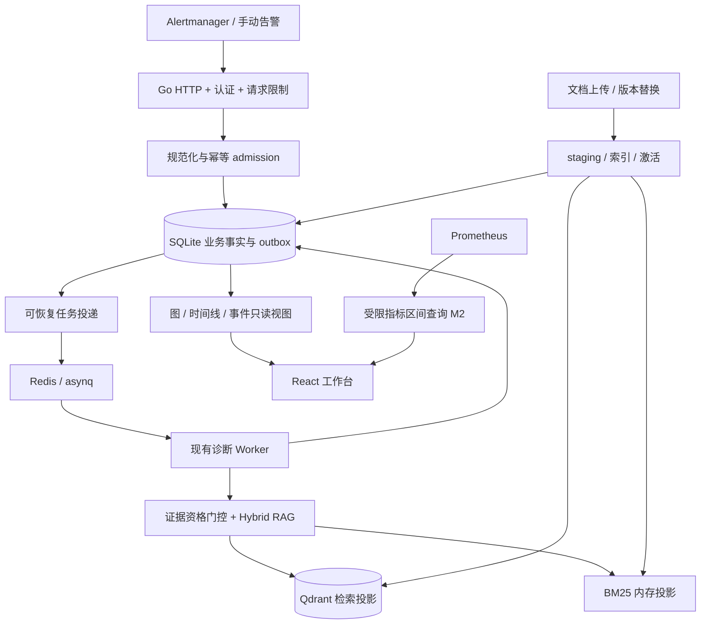

# 02 · 架构、数据与一致性

## 1. 数据路径

不直接从 Go handler 生成随意的“看起来合理”的连线。引用关系、检索记录和运行事件在业务动作发生时记录，图接口只将它们投影为节点和边。

## 2. 持久实体与最小字段

以下是逻辑表，不是要求使用 ORM。选择简单 SQL + repository；migration 有版本、事务和可恢复升级策略。

| 实体 / 表 | 核心字段与约束 |
|---|---|
| `incidents` | id；canonical_alert_key UNIQUE；source_namespace；environment；service；name；severity；lifecycle_status；starts_at；resolved_at；first_received_at；last_observed_at；identity_quality |
| `alert_observations` | id；incident_id；source_status；labels_json；annotations_json；starts_at；ends_at；received_at；source_event_key UNIQUE；保存原始观测，不任意覆写时间 |
| `diagnosis_runs` | id（新旧 report_id 共用）；business_key UNIQUE；status；dispatch_state；evidence_status；received_at；started_at；finished_at；current_attempt；revision；error_code；report_text；judge_score NULLABLE |
| `run_incidents` | run_id + incident_id 复合主键；将旧批量诊断和单事件视图连接起来 |
| `run_events` | event_id；run_id；attempt；sequence；stage；stage_attempt；kind；occurred_at；duration_ms NULLABLE；result_ref；error；UNIQUE(run_id,sequence)；写后不可变 |
| `documents` | id；source_namespace；source_kind；title；active_version_id；deleted_at；UNIQUE(source_namespace, normalized_title) |
| `document_versions` | id；document_id；content_sha256；完整 Markdown；created_at；status；embedding_space_id；index_status；前一版本；不可变正文 |
| `chunks` | id；version_id；ordinal；heading；snippet；content_sha256；UNIQUE(version_id,ordinal) |
| `retrievals` | id；run_id；incident_id；query；started_at；completed_at；retrieval_config_version；embedding_space_id；status |
| `retrieval_hits` | retrieval_id + chunk_id；rank；dense_score/BM25/RRF 分开；eligibility；使用原因；不是一个含混 score |
| `report_citations` | run_id；incident_id；retrieval_id；chunk_id；可选 statement_id；引用发生时的片段 hash；禁止跨 run 引用拼接 |
| `outbox` | id；kind=diagnosis/notification；dedupe_key UNIQUE；payload_snapshot；pending/sent/dead；attempts；next_attempt_at；last_error |
| `service_dependencies`（M2） | id；source/target canonical service id；environment；relation；source_ref；declared/observed；valid_from/to；recorded_at |
| `evidence_annotations`（M2可选） | 手工候选假设/核验记录及来源；不是直接编辑事实关系；必须有身份与时间 |

本包契约文件定义的是 `WorkspaceSnapshot` 前端读模型。具体 SQL 字段可以调整，但逻辑身份、生命周期与约束不可丢失。首版不单独维护全量 `graph_nodes/graph_edges` 真源表；它们由上述实体派生。

## 3. 身份和幂等

### 告警事件

将 `source_namespace + environment + 规范化完整 labels + starts_at(UTC)` 作为一个告警生命周期的 canonical key，排序 map 后 hash。规范化规则需版本化。annotations、接收时刻、随机 report_id 和数组排列不进入身份。服务/环境未知时显式为 unknown，不自行猜测。

首版一个 incident 对应一个告警实例生命周期，不自动声称多条告警同根因。批量 /alert 可以产生关联多个 incident 的一个 diagnosis run，保留旧批量报告语义。

兼容旧输入缺 `startsAt` 时，使用明确配置的 5 分钟接收时间桶 + canonical labels，并标记 `identity_quality=windowed`；只能承诺桶内去重，跨桶可能再次诊断，UI/日志可见。新集成要求 startsAt。不可把所有同名告警永久合并。

### 诊断 run

首次自动诊断 business key = source_namespace + 排序去重后的 incident key 集合 + policy_version。原样重投、换随机 HTTP request ID、重排数组均返回已有 run_id。完成后相同事件集合不会因队列 task 被清理而再次自动计费。

显式“重新诊断”才创建新的 run，使用客户端 Idempotency-Key；同一请求重复不再创建。不同成员集合可有不同 batch run，这是批量语义，不承诺对部分重叠集合消除每一次重复检索；不能把这个行为混淆为全局告警归因。

SQLite UNIQUE + 事务保护并发 admission；不能依赖“先查询是否存在再插入”的应用层竞态。worker 每个 attempt 有租约/版本栅栏，过期 attempt 不能覆盖较新终态。

### 原子性边界

SQLite 与 Redis 不是同一事务。事务先保存 run+关联+outbox，再投递 asynq；只要接受成功，待投递状态可恢复。未配置或已知不可用的 Redis 在新请求 admission 前返回 503；提交之后 Redis 瞬时失败可返回 202 已持久接受、`dispatch_state=pending`，由 outbox 重投。已有幂等结果照常返回，不制造新 failed 报告。ADR 需明确这一相对旧契约的补充。

Redis 仍是执行依赖，不回退进程内诊断。投递成功后进程崩溃可能重复投递；task ID、run 状态和 attempt 栅栏消除重复业务提交。外部 LLM 调用与本地事务不原子，崩溃窗口下不承诺 exactly-once 调用/费用。

## 4. 三套状态不可混合

| 维度 | 状态 | 规则 |
|---|---|---|
| incident lifecycle | active / resolved / unknown | 只有明确来源恢复事件或带来源的人工记录能置 resolved；列表暂时没看到告警不等于恢复 |
| diagnosis run | queued / running / succeeded / failed / cancelled | succeeded 表示诊断任务完成，可能是 no_evidence；不改变 incident 恢复状态 |
| evidence | not_evaluated / has_citations / no_evidence / source_unavailable | has_citations 不等于根因核验；unknown/故障不伪装空结果 |
| notification | disabled / pending / sent / failed | 与诊断成功独立，失败保留重试与完整 payload |
| stage | pending / running / succeeded / failed / skipped / cancelled | retry 记录在 attempt；重试成功的阶段应显示 succeeded + retry_count，不显示失败完成 |
| assertion verification | unverified / confirmed / rejected | human/rule 依据另记；LLM 评分不直接改变该状态 |

Score 未评分用 null；兼容旧接口时才适配回 score=0。LLM-as-judge 的 1–5 分是报告评价，不是 incident 健康度，更不是根因概率。默认不展示数值 confidence；有模型原始打分也要明确未校准。

恢复观测按 alert key 定位，核验 endsAt >= startsAt；同生命周期的迟到 firing 不覆盖已知较晚的 resolved 观测。没有足够 source 时间/顺序时标记冲突或 unknown，不自动“再开一次”。未匹配的恢复事件仅记录审计，不创建一次新的诊断。

## 5. 文档版本与索引

1. 上传/替换先保存新 version 为 staging，旧 active 不变；相同 hash 重投可直接返回已有结果。
2. embedding_space 必须固定包含 provider/model/配置版本/维度。相同维度也不意味着语义空间相同。
3. 将新 chunks 写入指定 Qdrant collection，payload 含 doc_id/version_id/chunk_id/space_id/source_namespace。临时中断保持 staging，不能返回已激活。
4. 新版本索引完整后，在 SQLite 事务中切 active_version_id，标记旧版本 superseded。BM25 由可恢复事实重建；单实例中使用版本快照或文档级同步保证切换观察一致。
5. 所有“当前检索”都要按 SQLite 可用活动版本做校验；不能只依赖跨系统批量改 active=true。候选过采样后过滤，不足时显式结果少于 K，不用旧版本凑数。版本过滤必须发生在最终 topK 与引用资格确认前。
6. 历史报告继续固定其原 version/chunk/snippet，不重新绑定到最新文档。旧 chunk 的全文留在 SQLite；过期向量可异步清理，不影响历史追溯。
7. 删除设置 tombstone 并立刻从当前检索排除，索引删除失败显示 cleanup_pending 并重试。默认保留历史引用快照；真正永久清除是未来显式敏感操作，不悄悄伪称已销毁所有历史文本。
8. 启动从 SQLite 恢复文档清单和 BM25，检查索引状态后才提供正常 readiness。Qdrant 不可用时返回明确 dependency error，不隐式切内存假成功。

没有分布式事务承诺。故障注入必须覆盖“向量已写 / SQLite 未激活”“激活成功 / 进程立即退出”“删除物理索引失败”等窗口。

## 6. 证据图读模型

节点类型：incident、alert、retrieval、document_chunk、report；M2 加 service、metric_observation；hypothesis 只有在存有明确来源的候选断言时加入。

确定性关系：contains、triggered、retrieved、cites、produced、observed_on、depends_on。候选判断关系：suggests、possibly_supports，必须 `basis=inferred` 且 `verification=unverified`，默认虚线。

每条边至少保存/返回 id、source、target、relation、basis、source_refs、recorded_at 和 verification。**fact 表示记录了这次行为/关系，不代表文档正文已被证明正确。** `retrieved` 更不能升级成 `causes`。

关系有方向但主图不是任意因果推断。反向索引关系在读模型中可以存在，M1 主展示选择“告警→检索→来源→报告”的有向子图避免视觉循环。ELK 不靠 force 动画表达算法运行。

图查询必须 server-side 过滤环境、事件、run 与文档权限。默认只取当前 incident 相关引用；不能把整个 batch 的 citations 连到每条告警。返回 truncated/omitted_counts；隐藏节点不能被统计成不存在。

## 7. 时间线

events 写入实际业务边界：alert_received、queue_admitted、worker_started、retrieval_started/completed/failed、report_assembled、judge_*、notification_*。每个事件有 sequence 和 attempt；前端按 sequence 去重排序。

原 Planner 是检索与报告拼装，不应伪造额外 LLM 生成步骤。UI 通用标签用“报告组装”；只有实际 LLM 调用发生时展示其子事件。[SRC-08]

持久时间戳 UTC/RFC3339，单次执行 duration 优先用单调时钟。队列等待使用服务器记录，接入异机时标明时钟误差；不从文本或动画反算耗时。跨重启恢复后旧 running attempt 记 interrupted/failed，再建立新 attempt，不能继续假装同一次毫秒计时。

时间旅行首版限于“查看该 run 当时记录的图与引用”；没有双时间事实存储时，禁止声称可以回到任意历史时刻重建完整服务网络。
